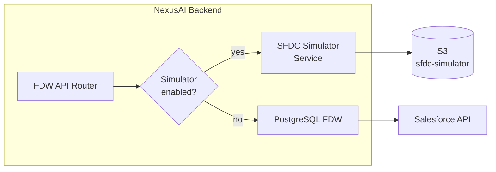

---
hide:
  - toc
---

# Enterprise Data Simulators

The platform ships built-in simulators that let development and QA teams test the full Data Plane and Reasoning Plane without connecting to live external systems. The currently shipped simulator targets the **CRM** path; additional source simulators (event streams, ERP) can be added as journey-specific test fixtures.

## In this section

- [SFDC / CRM Simulator](sfdc/index.md) -- in-memory data store backed by S3 dumps that replaces the live PostgreSQL FDW connection to Salesforce. Same `FDWDiscoveryService` / `FDWQueryService` interface as the real FDW so consuming code is unchanged.

## Architecture

When the simulator is enabled, the backend transparently routes Data Plane queries to the in-process simulator service instead of the real source system. No code changes are needed in consuming services -- the swap happens at the service-provider level.

## When to use

- **Local development** -- run the full agent loop and Solution apps without touching production CRM data.
- **CI / E2E testing** -- spin up a deterministic dataset, run BDD scenarios, tear down.
- **Demo / sales** -- show the Solutions Catalogue (e.g. Order-to-Cash Monitor) with a representative dataset, no Salesforce connection required.
- **Schema rehearsal** -- dump a current Salesforce snapshot, point the platform at it, validate the Knowledge Pipeline and ontology before flipping to production.

## Mode toggle

Two ways to switch between simulator and real mode:

- **UI** -- *Operations -> Simulators -> Salesforce Simulator -> Switch to Real / Switch to Simulator*.
- **API** -- `PUT /api/v1/config/sfdc-mode` with `{"enabled": true|false}`.

The mode is persisted in AWS SSM (`/nexus-ai/{env}/sfdc/enabled`) and applies on the next FDW query.

## Related references

- [SFDC / CRM Simulator](sfdc/index.md) -- detailed guide.
- [Data Plane](../planes/data-plane.md) -- the layer the simulator sits behind.
- [Implementation Guide](../ai-os/implementation-guide.md) -- production code mapping for the FDW path.
