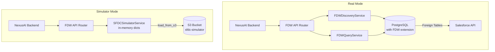
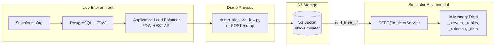
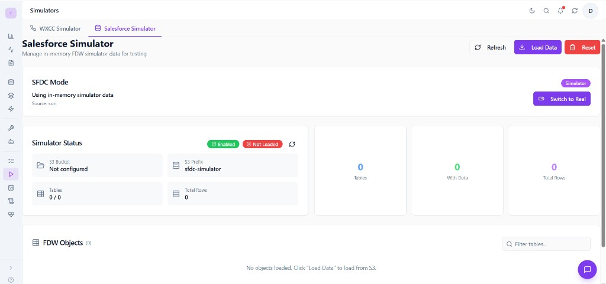

# Enterprise Data Simulator - CRM (Salesforce)

## Overview

The **SFDC (Salesforce) Simulator** replaces the live PostgreSQL Foreign Data Wrapper (FDW) connection to Salesforce with an in-memory data store backed by S3 dumps. This allows the NexusAI platform to query Salesforce CRM data (Accounts, Leads, Opportunities, Contacts, and custom objects) during development and testing without a live Salesforce org or a PostgreSQL FDW extension.

For the simulator overview and mode-toggle mechanics, see [Simulators](../index.md). For the underlying production code path, see [Implementation Guide > Data Plane](../../ai-os/implementation-guide.md#data-plane).

**Key capabilities:**

- Loads a complete snapshot of Salesforce FDW tables from S3 into memory
- Implements the same `FDWDiscoveryService` and `FDWQueryService` interfaces as the real FDW, so consuming code works unchanged
- Supports filtering, sorting, pagination, and column selection on in-memory data
- Can dump fresh data from a live FDW runtime to S3 for later use
- Mode can be toggled between Simulator and Real at runtime via the UI or API

---

## Architecture

### Real Mode vs Simulator Mode

The platform uses `SFDC_SIMULATOR_ENABLED` (and the SSM parameter `/nexus-ai/{env}/sfdc/enabled`) to decide how FDW queries are served. When the simulator is enabled, `fdw_api.configure()` injects the `SFDCSimulatorService` in place of the real PostgreSQL FDW services.



### Interface Compatibility

The `SFDCSimulatorService` implements the same method signatures as the real services:

| Interface | Methods | Description |
|-----------|---------|-------------|
| `FDWDiscoveryService` | `list_foreign_servers()`, `list_foreign_tables()`, `get_table_columns()`, `refresh_cache()` | Schema discovery (servers, tables, columns) |
| `FDWQueryService` | `execute_query()` | Data queries with filters, sorting, pagination |

This means **no code changes** are required in any FDW consumer -- the swap is transparent.

### Component Map

| Component | Location | Role |
|-----------|----------|------|
| **SFDCSimulatorService** | `nexus-backend/src/services/sfdc_simulator_service.py` | Core service: loads S3 dumps, serves queries in-memory |
| **Simulator API** | `nexus-backend/src/apis/sfdc_simulator_api.py` | FastAPI router for simulator admin operations |
| **Dump Script** | `nexus-backend/scripts/sfdc-simulator/dump_sfdc_via_fdw.py` | CLI tool to dump live FDW data to S3 |
| **FDW Models** | `nexus-backend/src/models/fdw_models.py` | Shared Pydantic models (ForeignServerInfo, ForeignTableInfo, etc.) |
| **UI Panel** | `nexus-ui/src/components/sfdc-simulator/SFDCSimulatorPanel.tsx` | Main React component for the Salesforce Simulator tab |
| **UI Service** | `nexus-ui/src/services/sfdcSimulatorService.ts` | Frontend API client |

### S3 Storage Layout

Data is stored in a structured JSON format under a single S3 prefix:

```
s3://{bucket}/{prefix}/
├── manifest.json                        # Dump metadata (timestamp, source, counts)
├── servers.json                         # Foreign server definitions
├── tables.json                          # Foreign table list (all schemas)
├── columns/
│   ├── nexus_data.Account.json    # Column metadata per table
│   ├── nexus_data.Lead.json
│   └── ...
├── data/
│   ├── nexus_data.Account.json    # Row data per table
│   ├── nexus_data.Lead.json
│   └── ...
└── _dump_status.json                    # Current dump operation status
```

| File | Contents |
|------|----------|
| `manifest.json` | Dump timestamp, source URL, schema name, table/row counts, elapsed time |
| `servers.json` | Array of FDW server definitions (server name, wrapper type, options) |
| `tables.json` | Array of all foreign tables (schema, table name, server, column count) |
| `columns/{schema}.{table}.json` | Array of column metadata (name, data type, nullable, ordinal position) |
| `data/{schema}.{table}.json` | Array of row objects (or `{"rows": [...]}` format) |
| `_dump_status.json` | Tracks whether a dump is currently running (for multi-pod consistency) |

---

## Data Sources and Population

### Where the Data Comes From

Unlike the WXCC simulator which generates synthetic data, the SFDC simulator uses **real Salesforce data** that has been dumped from a live FDW runtime. The data flow is:



### Dump Process

The dump process queries a running FDW API to extract:

1. **Foreign servers** -- via `GET /api/fdw/servers`
2. **Foreign tables** -- via `GET /api/fdw/tables`
3. **Column metadata** -- via `GET /api/fdw/tables/{schema}/{table}/columns` for each table
4. **Row data** -- via `POST /api/fdw/query` for each selected table

### Priority Tables

When dumping without specifying tables, only high-value tables are included by default:

| Table | Type |
|-------|------|
| `Account` | Standard Salesforce object |
| `Lead` | Standard Salesforce object |
| `Opportunity` | Standard Salesforce object |
| `Contact` | Standard Salesforce object |
| `RecordType` | Standard Salesforce object |
| `cspmb__Price_Item__c` | Custom managed package object |
| `ContentVersion` | File/document versions |
| `ContentDocumentLink` | Document-to-record associations |
| `Note` | Note records |

Use `--all` to dump every table in the schema (slower, but comprehensive).

### Load Process

When the simulator starts (or when **Load Data** is clicked in the UI):

1. `manifest.json` is downloaded and validated
2. `servers.json` is parsed into `ForeignServerInfo` objects
3. `tables.json` is parsed into `ForeignTableInfo` objects
4. All `columns/*.json` files are downloaded and parsed into `ColumnInfo` lists, indexed by `(schema, table)` tuple
5. All `data/*.json` files are downloaded and parsed into row lists, indexed by `(schema, table)` tuple
6. The service sets `_loaded = True` and records the load timestamp

The loaded data is fully queryable via the standard FDW query interface.

---

## Using the Simulator (UI)

The SFDC Simulator is accessed via **Operations > Simulators > Salesforce Simulator** tab.

### Page Layout



The Salesforce Simulator page is organized into these sections:

1. **Header** -- Title, Refresh / Load Data / Reset buttons
2. **SFDC Mode Toggle** -- Switch between Simulator and Real mode
3. **Simulator Status** -- Card showing enabled/loaded state, S3 bucket/prefix, table and row counts
4. **Statistics** -- Visual summary: Tables, Tables With Data, Total Rows
5. **FDW Objects Table** -- List of all loaded foreign tables with schema, name, column count, row count
6. **Dump from Live FDW** -- Section for creating fresh dumps from a running real FDW

### Mode Toggle

The mode toggle at the top of the page (visible in the overview screenshot as "SFDC Mode") shows the current data source:

- **Simulator** badge (green) -- The platform is using in-memory simulator data.
- **Real** badge -- The platform is using the live PostgreSQL FDW connection.

Click **Switch to Real** or **Switch to Simulator** to toggle the mode. This:

1. Updates the SSM parameter `/nexus-ai/{env}/sfdc/enabled`
2. Changes how `fdw_api` resolves its service providers
3. Takes effect immediately for subsequent FDW queries

!!! warning
    Switching to Real mode requires a working PostgreSQL FDW connection with valid Salesforce credentials. If the FDW is not configured, queries will fail.

### Loading Data

Click **Load Data** in the header to trigger `SFDCSimulatorService.load_from_s3()`. This downloads all S3 dump files into memory. The status card will update to show:

- **Loaded** badge (green) -- Data is ready to serve
- **Not Loaded** badge (red) -- No data in memory (need to click Load Data)

The load operation runs in the background and typically completes in a few seconds for small datasets, or up to 30 seconds for large schemas.

!!! tip "Auto-Load"
    The service auto-loads from S3 on the first query if data hasn't been loaded yet (`ensure_loaded()` is called before any query). However, clicking Load Data explicitly gives you visibility into the load result.

### Simulator Status Card

The status card displays:

| Field | Description |
|-------|-------------|
| Enabled | Whether the simulator service is active |
| Loaded | Whether S3 data has been loaded into memory |
| S3 Bucket | The S3 bucket holding the dump data |
| S3 Prefix | The S3 key prefix (default: `sfdc-simulator`) |
| Tables | Total number of foreign tables in the dump |
| Tables with Data | Number of tables that have at least one row |
| Total Rows | Sum of all row counts across all tables |
| Dump Timestamp | When the S3 data was originally dumped |
| Last Loaded | When the data was last loaded into memory |

### FDW Objects Table

The FDW Objects table (visible at the bottom of the overview screenshot) lists all loaded foreign tables:

| Column | Description |
|--------|-------------|
| Schema | Salesforce schema name (e.g., `nexus_data`) |
| Table | Table name (e.g., `Account`, `Lead`, `Opportunity`) |
| Columns | Number of columns in the table |
| Rows | Number of data rows loaded |

Click any row to open the **Data Browser Modal**, which shows the actual records in a paginated table.

A filter input above the table lets you search tables by name.

### Data Browser Modal

Clicking a table row opens a modal displaying:

- Column headers matching the table schema
- Row data in a scrollable, paginated table
- Navigation controls (limit, offset)

This is useful for verifying that the dump contains the expected data before running analytics pipelines.

### Dump from Live FDW

The **Dump from Live FDW** section at the bottom of the page allows you to create a fresh data snapshot from a running real FDW environment:

1. Enter the **Source URL** of a deployed FDW runtime (the ALB URL).
2. Optionally specify a schema name (default: `nexus_data`).
3. Click **Start Dump**.

The dump runs in the background, querying the live FDW API and uploading results to S3. Progress is tracked via `_dump_status.json` in S3 for multi-pod consistency.

After the dump completes, click **Load Data** to refresh the in-memory data from the new S3 dump.

### Resetting Data

Click **Reset** to reload the original S3 dump into memory. This discards any in-memory modifications and re-fetches all data from S3, effectively restoring the simulator to its last-dumped state.

---

## Using the Simulator (CLI)

### Dump Script

The dump script (`nexus-backend/scripts/sfdc-simulator/dump_sfdc_via_fdw.py`) extracts data from a live FDW runtime and saves it to S3 or a local directory.

#### Basic Usage

```bash
# Dump priority tables from a deployed environment to S3
python scripts/sfdc-simulator/dump_sfdc_via_fdw.py \
  --url http://k8s-alb.elb.amazonaws.com \
  --s3-bucket nexus-ai-dev-sfdc-simulator

# Auto-detect ALB URL from kubectl and dump to S3
python scripts/sfdc-simulator/dump_sfdc_via_fdw.py \
  --auto-detect \
  --s3-bucket nexus-ai-dev-sfdc-simulator

# Dump specific tables only
python scripts/sfdc-simulator/dump_sfdc_via_fdw.py \
  --url http://k8s-alb.elb.amazonaws.com \
  --tables Account,Lead,Contact,Opportunity \
  --s3-bucket nexus-ai-dev-sfdc-simulator

# Dump ALL tables (slow -- queries every table in the schema)
python scripts/sfdc-simulator/dump_sfdc_via_fdw.py \
  --url http://k8s-alb.elb.amazonaws.com \
  --all \
  --s3-bucket nexus-ai-dev-sfdc-simulator

# Local-only dump (no S3 upload)
python scripts/sfdc-simulator/dump_sfdc_via_fdw.py \
  --url http://k8s-alb.elb.amazonaws.com \
  --local-dir ./sfdc-dump
```

### CLI Options Reference

| Option | Type | Default | Description |
|--------|------|---------|-------------|
| `--url` | URL | -- | ALB URL of the deployed FDW runtime |
| `--auto-detect` | flag | off | Auto-detect ALB URL from `kubectl get ingress` |
| `--namespace` | string | all | Kubernetes namespace for auto-detection |
| `--schema` | string | `nexus_data` | PostgreSQL schema to dump |
| `--tables` | string | -- | Comma-separated table names (overrides priority list) |
| `--all` | flag | off | Dump data for all tables in the schema |
| `--limit` | int | 10,000 | Max rows per table |
| `--s3-bucket` | string | -- | S3 bucket for upload |
| `--s3-prefix` | string | `sfdc-simulator` | S3 key prefix |
| `--aws-profile` | string | `external-access` | AWS CLI profile name |
| `--local-dir` | path | -- | Local directory for dump (alternative to S3) |

!!! note
    Either `--s3-bucket` or `--local-dir` (or both) must be specified.

---

## API Reference

### Simulator Admin Endpoints (`/api/v1/sfdc-simulator`)

| Method | Endpoint | Description |
|--------|----------|-------------|
| GET | `/status` | Simulator status (enabled, loaded, bucket, table/row counts) |
| POST | `/load` | Load data from S3 into memory (background) |
| POST | `/reset` | Reset (reload from S3) |
| GET | `/objects` | List all loaded tables with row counts |
| GET | `/objects/{schema}/{table}` | Get records for a table (supports `limit`, `offset` query params) |
| GET | `/objects/{schema}/{table}/columns` | Get column metadata for a table |
| POST | `/dump` | Dump from a live FDW runtime to S3 (background) |
| GET | `/dump/status` | Check dump operation progress |
| POST | `/restart-pods` | Rolling restart of backend pods |
| GET | `/health` | Health check |

### Config Endpoints (`/api/v1/config`)

| Method | Endpoint | Description |
|--------|----------|-------------|
| GET | `/sfdc-mode` | Get current SFDC mode (`simulator` or `real`) |
| PUT | `/sfdc-mode` | Set SFDC mode (body: `{"enabled": true/false}`) |

### Example: Get Simulator Status

```bash
curl http://localhost:8000/api/v1/sfdc-simulator/status
```

Response:

```json
{
  "enabled": true,
  "loaded": true,
  "bucket": "nexus-ai-dev-sfdc-simulator",
  "prefix": "sfdc-simulator",
  "schema": "nexus_data",
  "table_count": 245,
  "tables_with_data": 12,
  "total_rows": 8543,
  "dump_timestamp": "2026-03-14T10:30:00+00:00",
  "last_loaded": "2026-03-15T08:00:00+00:00"
}
```

### Example: Load Data from S3

```bash
curl -X POST http://localhost:8000/api/v1/sfdc-simulator/load
```

Response:

```json
{
  "success": true,
  "message": "Loaded 245 tables, 12 with data, 8543 rows in 3.2s",
  "tables": 245,
  "tables_with_data": 12,
  "total_rows": 8543
}
```

### Example: Toggle Mode

```bash
# Switch to simulator mode
curl -X PUT http://localhost:8000/api/v1/config/sfdc-mode \
  -H "Content-Type: application/json" \
  -d '{"enabled": true}'

# Switch to real FDW mode
curl -X PUT http://localhost:8000/api/v1/config/sfdc-mode \
  -H "Content-Type: application/json" \
  -d '{"enabled": false}'
```

### Example: Browse Table Data

```bash
# Get first 50 rows from the Account table
curl "http://localhost:8000/api/v1/sfdc-simulator/objects/nexus_data/Account?limit=50&offset=0"
```

---

## Configuration Reference

### Environment Variables

| Variable | Default | Description |
|----------|---------|-------------|
| `SFDC_SIMULATOR_ENABLED` | `false` | Enable the SFDC simulator (use in-memory data instead of real FDW) |
| `SFDC_SIMULATOR_BUCKET` | -- | S3 bucket containing the FDW data dump |
| `SFDC_SIMULATOR_PREFIX` | `sfdc-simulator` | S3 key prefix for dump files |

### System Settings (UI)

The SFDC Simulator settings are also available in the application **Settings** page under **System > SFDC Simulator**. This provides an admin-friendly UI for editing the SSM parameters without using the CLI or API:

| Setting | Type | Default | Description |
|---------|------|---------|-------------|
| Enabled | Toggle | off | Enable SFDC simulator mode (use in-memory data instead of real FDW) |
| Bucket | Text | `nexus-ai-{env}-sfdc-simulator` | S3 bucket for SFDC simulator data dumps |
| Prefix | Text | `sfdc-simulator` | S3 prefix for SFDC simulator data |

Changes are persisted to AWS SSM Parameter Store and take effect immediately. Use **Save Changes** to apply or **Reset** to revert to defaults.

### AWS SSM Parameters

| Parameter Path | Description |
|---------------|-------------|
| `/nexus-ai/{env}/sfdc/enabled` | `true`/`false` -- master enable flag (toggled by Config API or Settings UI) |
| `/nexus-ai/{env}/sfdc/bucket` | S3 bucket name for simulator data dumps |
| `/nexus-ai/{env}/sfdc/prefix` | S3 key prefix for dump files |

### In-Memory Data Structure

When loaded, the service holds data in these Python structures:

| Attribute | Type | Description |
|-----------|------|-------------|
| `_servers` | `List[ForeignServerInfo]` | Foreign server definitions |
| `_tables` | `List[ForeignTableInfo]` | Foreign table metadata |
| `_columns` | `Dict[(schema, table), List[ColumnInfo]]` | Column metadata indexed by table |
| `_data` | `Dict[(schema, table), List[dict]]` | Row data indexed by table |
| `_manifest` | `Dict` | Dump metadata (source, timestamp, counts) |
| `_loaded` | `bool` | Whether data has been loaded from S3 |
| `_loaded_at` | `datetime` | When the last load completed |

### Query Capabilities

The in-memory query engine supports:

| Feature | Description |
|---------|-------------|
| **Column selection** | Return only specified columns |
| **Filtering** | Operators: `eq`, `neq`, `gt`, `gte`, `lt`, `lte`, `like`, `in` |
| **Sorting** | Single or multiple `order_by` clauses, ascending or descending |
| **Pagination** | `limit` and `offset` for page-based access |

---

## Troubleshooting

### Status shows "Not Loaded" after pod restart

The in-memory data does not persist across pod restarts. Click **Load Data** or wait for the first query to trigger auto-loading via `ensure_loaded()`.

### "manifest.json not found in S3" error

The S3 bucket has no dump data. You need to create a dump first:

1. Use the **Dump from Live FDW** section in the UI, or
2. Run the dump script: `python scripts/sfdc-simulator/dump_sfdc_via_fdw.py --url <ALB_URL> --s3-bucket <BUCKET>`

### Load takes a long time or times out

Large schemas with hundreds of tables and thousands of rows can take 30+ seconds to load. Solutions:

- Dump only priority tables (the default) instead of using `--all`.
- Check the S3 bucket region matches the pod's region to minimize latency.
- If a single table has an excessive number of rows, re-dump with a lower `--limit`.

### Mode switch has no effect

- Verify the SSM parameter was updated: `GET /api/v1/config/sfdc-mode`
- The mode change affects new queries but does not reload data. If switching to simulator, ensure data is loaded.
- Some operations may cache the mode at startup. A pod restart (`POST /api/v1/sfdc-simulator/restart-pods`) ensures all pods pick up the new mode.

### FDW Objects table shows 0 rows for all tables

The dump may have only captured metadata (servers, tables, columns) without row data. Check `manifest.json`:

```bash
aws s3 cp s3://<bucket>/sfdc-simulator/manifest.json - | python -m json.tool
```

Look at `tables_with_data` and `total_rows_dumped`. If zero, re-run the dump with explicit table names or `--all`.

### Dump fails with connection errors

- Verify the source URL points to a running FDW runtime with valid `/api/fdw/servers` endpoint.
- Check that the source environment has valid Salesforce FDW credentials configured.
- Increase `--limit` timeout if tables have very large row counts.
- Ensure the dump script has network access to the ALB (VPN, security groups, etc.).

### Data appears stale

The simulator serves whatever was last loaded from S3. To get fresh data:

1. Run a new dump from the live FDW (UI or CLI).
2. Click **Load Data** (or **Reset**) to reload from S3.
