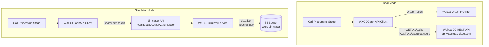
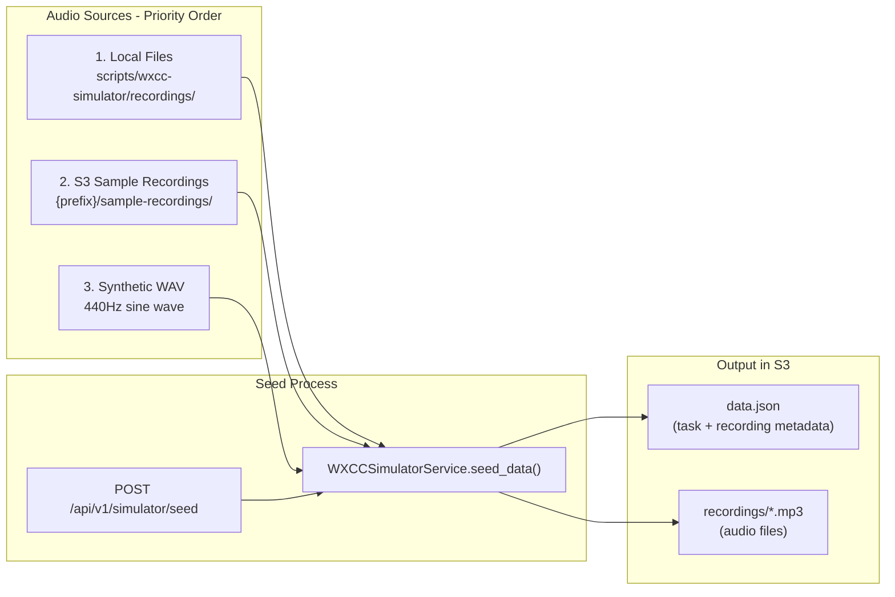
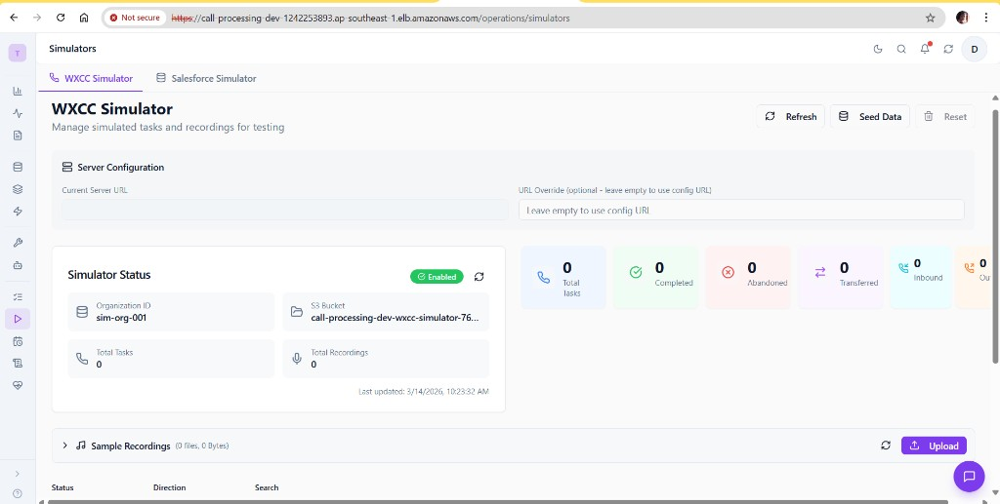

# Enterprise Data Simulator - Contact Center (WXCC)

!!! info "Screenshots"
    To capture additional screenshots of the simulator UI, run the Playwright script:
    `python3 docs/simulators/capture-simulator-screenshots.py`

---

## Overview

The **WXCC Simulator** provides a fully functional mock of the Cisco Webex Contact Center (WXCC) API within the NexusAI platform. It allows teams to develop, test, and demo the data-processing pipeline -- including task ingestion, recording retrieval, transcription, and analytics -- without requiring a live Webex CC tenant or OAuth credentials.

**Key capabilities:**

- Creates realistic call tasks with randomized metadata (phone numbers, queues, agents, statuses)
- Stores and streams call recordings from S3 (real audio files or synthetic fallback)
- Exposes WXCC-compatible REST endpoints consumed by the existing nexus-ai stages
- Managed entirely through the UI, CLI, or REST API

---

## Architecture

### Real Mode vs Simulator Mode

The platform uses a feature flag (`WXCC_SIMULATOR_ENABLED`) to decide which backend serves WXCC data. When the simulator is enabled, the `WXCCGraphAPI` client routes requests to the local simulator API instead of the real Webex CC endpoints.



### Component Map

| Component | Location | Role |
|-----------|----------|------|
| **WXCCSimulatorService** | `nexus-backend/src/services/wxcc_simulator_service.py` | Core service: S3 storage, task/recording CRUD, seeding, caching |
| **Simulator API** | `nexus-backend/src/apis/wxcc_simulator_api.py` | FastAPI router exposing WXCC-compatible + admin endpoints |
| **Simulator Processor** | `nexus-backend/src/stages/wxcc-simulator/simulator_processor.py` | Stage processor that feeds simulator tasks into the pipeline |
| **Simulator Stage** | `nexus-backend/src/stages/wxcc-simulator/wxcc_simulator_stage.py` | Journey stage definition for WXCC simulator |
| **Seed Script** | `nexus-backend/scripts/wxcc-simulator/seed_simulator.py` | CLI tool to seed/reset the simulator |
| **MCP Tool** | `nexus-backend/src/tools/wxcc_simulator_tool.py` | AI tool for programmatic simulator interaction |
| **UI Panel** | `nexus-ui/src/components/wxcc-simulator/WXCCSimulatorPanel.tsx` | Main React component for the WXCC simulator tab |
| **UI Service** | `nexus-ui/src/services/wxccSimulatorService.ts` | Frontend API client |

### S3 Storage Layout

All simulator data lives under a single S3 bucket with the following prefix structure:

```
s3://{bucket}/{prefix}/
├── data.json                    # Task and recording metadata (JSON)
├── recordings/
│   ├── {uuid}.mp3               # Actual call recording files
│   ├── {uuid}.wav
│   └── ...
└── sample-recordings/
    ├── call-sample-01.mp3       # Source audio used during seeding
    ├── call-sample-02.wav
    └── ...
```

| File | Purpose |
|------|---------|
| `data.json` | Central metadata store containing all tasks and recording references |
| `recordings/` | Audio files associated with specific tasks (copied from samples during seeding) |
| `sample-recordings/` | Pool of source audio files that get randomly assigned to tasks during seeding |

---

## Data Sources and Population

### How Data Gets Into the Simulator

The simulator is populated through **seeding** -- a process that generates mock task records and optionally associates audio recordings with each task.



### Recording Source Priority

When seeding tasks with recordings, the service selects audio files in this order:

1. **Local recordings** -- Files in `nexus-backend/scripts/wxcc-simulator/recordings/` (MP3, WAV, M4A, OGG, FLAC). Best for local development where you have actual call recordings.
2. **S3 sample recordings** -- Files previously uploaded to `s3://{bucket}/{prefix}/sample-recordings/`. Used in Docker/Kubernetes environments where local files are unavailable. Cached via an LRU cache (max 20 files, 50 MB).
3. **Synthetic audio** -- As a last resort, a 440 Hz sine wave WAV file is generated programmatically. This produces valid audio but has no speech content.

### Sample Task Data

Seeded tasks use randomized values from these pools:

| Attribute | Sample Values |
|-----------|--------------|
| **Origins** | `+6591234567`, `+6598765432`, `+6581112222`, `+6589998888`, `+6577776666`, `+6566665555` |
| **Destinations** | `+6560001111`, `+6560002222`, `+6560003333` |
| **Queues** | Sales Queue, Technical Support, Billing Inquiries |
| **Agents** | John Smith (`agent-001`), Jane Doe (`agent-002`), Bob Wilson (`agent-003`) |
| **Task Names** | Inbound Sales Call, Technical Support Request, Billing Inquiry, Account Update, Service Complaint |
| **Statuses** | Completed (85%), Abandoned (10%), Transferred (5%) |
| **Directions** | Inbound, Outbound (equal probability) |
| **Duration** | 60-600 seconds (1-10 minutes) |

---

## Using the Simulator (UI)

The WXCC Simulator is accessed via **Operations > Simulators > WXCC Simulator** tab.

### Page Layout



The WXCC Simulator page is organized into these sections:

1. **Header** -- Title, Refresh / Seed Data / Reset buttons
2. **Server Configuration** -- Shows the current server URL and an optional URL override field
3. **Simulator Status** -- Card displaying enabled state, Organization ID, S3 bucket, task/recording counts, last updated timestamp
4. **Statistics** -- Visual breakdown of task counts by status (Total, Completed, Abandoned, Transferred, Inbound, Outbound)
5. **Sample Recordings** -- Collapsible section for managing source audio files
6. **Filter Controls** -- Filter tasks by status, direction, and text search
7. **Tasks Table** -- Paginated table of all simulator tasks
8. **Task Details Modal** -- Click a task row to view full details and play recordings

### Server Configuration

The Server Configuration section at the top of the page shows:

- **Current Server URL** -- The backend URL the simulator is running on (read-only).
- **URL Override** -- An optional field to point the simulator at a different backend URL. Leave empty to use the default from the application config.

### Seeding Data

To populate the simulator with test data:

1. Click **Seed Data** in the header.
2. The Seed Data dialog appears with the following configuration options:
3. Configure the seed parameters:

| Parameter | Range | Default | Description |
|-----------|-------|---------|-------------|
| Number of Tasks | 1 - 100 | 10 | How many mock call tasks to create |
| Days Back | 0 - 30 | 7 | Time span over which tasks are distributed |
| Include sample recordings | on/off | on | Attach audio files to tasks |
| Reset existing data first | on/off | off | Delete all existing data before seeding |

4. Click **Seed Data** to begin. The process creates tasks, uploads recordings to S3, and updates `data.json`.

!!! tip "Quick Testing"
    For immediate testing with the nexus-ai pipeline, use a small number of tasks (2-5) with "Reset existing data first" enabled. The tasks will be created with recent timestamps.

### Managing Sample Recordings

The **Sample Recordings** section (collapsible, visible at the bottom of the overview screenshot) lets you manage the pool of source audio files:

- **Upload** -- Click **Upload** to add MP3, WAV, M4A, OGG, or FLAC files. These are stored in `s3://{bucket}/{prefix}/sample-recordings/` and used during subsequent seeding.
- **List** -- Shows all uploaded sample recordings with file name, size, and last modified date.
- **Delete** -- Remove individual sample recordings from S3.

!!! note
    Sample recordings are distinct from task recordings. Sample recordings are the *source pool*; during seeding, files are randomly selected from this pool and copied into the `recordings/` prefix as task-specific recordings.

### Browsing Tasks

The tasks table (below the Sample Recordings section) displays all simulator tasks with columns:

| Column | Description |
|--------|-------------|
| Status | Completed, Abandoned, or Transferred (with color-coded icons) |
| Direction | Inbound or Outbound |
| Task Name | Randomly assigned task type |
| Origin | Caller phone number |
| Destination | Called number |
| Queue | Queue the call was routed to |
| Agent | Agent who handled the call |
| Created | Timestamp when the task was created |
| Recordings | Number of recordings attached |

**Filtering:**

- **Status filter** -- Show only Completed, Abandoned, or Transferred tasks
- **Direction filter** -- Show only Inbound or Outbound tasks
- **Search** -- Free-text search across task name, origin, destination, queue, agent

### Viewing Task Details

Click any task row to open the **Task Details Modal**, which shows:

- Full task metadata (ID, name, channel type, timestamps)
- Task attributes (status, direction, origin, destination, queue, agent)
- Associated recordings with an inline audio player for playback

### Resetting the Simulator

Click **Reset** in the header to delete all tasks and recordings from the simulator. A confirmation dialog appears before the action is executed. This:

1. Deletes all recording files from S3
2. Clears the `data.json` metadata
3. Resets task and recording counts to zero

---

## Using the Simulator (CLI)

### Seed Script

The seed script (`nexus-backend/scripts/wxcc-simulator/seed_simulator.py`) supports two modes:

#### API Mode (gateway running)

```bash
# Seed 10 tasks over 7 days with recordings (default)
python scripts/wxcc-simulator/seed_simulator.py --api http://localhost:8000

# Seed 50 tasks over 14 days
python scripts/wxcc-simulator/seed_simulator.py --api http://localhost:8000 --tasks 50 --days 14

# Reset and re-seed with current timestamps
python scripts/wxcc-simulator/seed_simulator.py --api http://localhost:8000 --reset --tasks 5 --now

# Check simulator status
python scripts/wxcc-simulator/seed_simulator.py --api http://localhost:8000 --status
```

#### Direct S3 Mode (no gateway required)

```bash
# Seed directly to S3 (auto-detects bucket from .env.local)
python scripts/wxcc-simulator/seed_simulator.py --tasks 20

# Seed with explicit bucket
python scripts/wxcc-simulator/seed_simulator.py --bucket nexus-ai-dev-wxcc-simulator --tasks 20

# Upload local sample recordings to S3 (one-time setup for Docker)
python scripts/wxcc-simulator/seed_simulator.py --upload-samples --bucket nexus-ai-dev-wxcc-simulator
```

### CLI Options Reference

| Option | Type | Default | Description |
|--------|------|---------|-------------|
| `--api` | URL | -- | Seed via API (provide gateway URL) |
| `--tasks` | int | 10 | Number of tasks to create |
| `--days` | int | 7 | Spread tasks over this many days |
| `--no-recordings` | flag | off | Skip recording creation |
| `--org-id` | string | `sim-org-001` | Organization ID |
| `--reset` | flag | off | Reset simulator before seeding |
| `--now` | flag | off | Use current timestamp for all tasks |
| `--bucket` | string | auto-detected | S3 bucket name |
| `--prefix` | string | `wxcc-simulator` | S3 prefix |
| `--region` | string | `ap-southeast-1` | AWS region |
| `--upload-samples` | flag | off | Upload all local recordings to S3 `sample-recordings/` prefix |
| `--upload-recording` | path | -- | Upload a single recording file |
| `--status` | flag | off | Show simulator status and exit |

### Bucket Auto-Detection

When `--bucket` is not specified, the script auto-detects the bucket name using:

1. `WXCC_SIMULATOR_BUCKET` environment variable
2. Constructed from `CAPABILITY_NAME` + `ENVIRONMENT`: `{capability}-{env}-wxcc-simulator`
3. Values loaded from `.env.local` in the project root

---

## API Reference

All endpoints are under `/api/v1/simulator`.

### WXCC-Compatible Endpoints

These endpoints match the Webex CC API contract, allowing the existing nexus-ai code to work unchanged.

| Method | Endpoint | Description |
|--------|----------|-------------|
| GET | `/tasks` | List tasks (supports `from`, `to`, `orgId`, `channelType`, `pageSize` query params) |
| POST | `/captures/query` | Get recordings for a list of task IDs (body: `{"taskIds": [...]}`) |
| GET | `/recordings/{id}` | Stream recording audio (returns audio bytes) |
| GET | `/recordings/{id}/url` | Get a presigned S3 URL for direct download |

### Admin Endpoints

| Method | Endpoint | Description |
|--------|----------|-------------|
| GET | `/status` | Simulator status (enabled, org, bucket, counts) |
| GET | `/admin/tasks` | List all tasks with summary info |
| POST | `/tasks` | Create a single task |
| PUT | `/tasks/{id}` | Update a task |
| DELETE | `/tasks/{id}` | Delete a task and its recordings |
| POST | `/tasks/{id}/recordings` | Upload a recording for a task |
| POST | `/seed` | Seed sample data |
| POST | `/reset` | Reset all data |
| GET | `/sample-recordings` | List sample recordings |
| POST | `/sample-recordings` | Upload a sample recording (multipart form) |
| DELETE | `/sample-recordings/{filename}` | Delete a sample recording |
| GET | `/health` | Health check |

### Config Endpoints

| Method | Endpoint | Description |
|--------|----------|-------------|
| GET | `/api/v1/config/wxcc-mode` | Get current WXCC mode (`simulator` or `real`) |

### Example: Seed via API

```bash
curl -X POST http://localhost:8000/api/v1/simulator/seed \
  -H "Content-Type: application/json" \
  -d '{
    "num_tasks": 10,
    "include_recordings": true,
    "days_back": 7,
    "use_current_time": false
  }'
```

### Example: Get Simulator Status

```bash
curl http://localhost:8000/api/v1/simulator/status
```

Response:

```json
{
  "enabled": true,
  "org_id": "sim-org-001",
  "bucket": "nexus-ai-dev-wxcc-simulator",
  "prefix": "wxcc-simulator",
  "task_count": 10,
  "recording_count": 10,
  "last_updated": "2026-03-15T08:30:00Z"
}
```

---

## Configuration Reference

### Environment Variables

| Variable | Default | Description |
|----------|---------|-------------|
| `WXCC_SIMULATOR_ENABLED` | `true` | Enable the WXCC simulator |
| `WXCC_SIMULATOR_BUCKET` | `nexus-ai-{env}-wxcc-simulator` | S3 bucket for simulator data |
| `WXCC_SIMULATOR_PREFIX` | `wxcc-simulator` | S3 key prefix |
| `WXCC_SIMULATOR_BASE_URL` | `http://localhost:8000` | Base URL used in recording file paths |
| `WXCC_SIM_ORG_ID` | `sim-org-001` | Simulated organization ID |
| `WXCC_SIM_TOKEN` | `test-token-12345` | Bearer token for simulator authentication |

### System Settings (UI)

The WXCC Simulator settings are also available in the application **Settings** page under **System > WXCC Simulator**. This provides an admin-friendly UI for editing the SSM parameters:

| Setting | Type | Default | Description |
|---------|------|---------|-------------|
| Enabled | Toggle | on | Enable WXCC simulator mode |
| Bucket | Text | `nexus-ai-{env}-wxcc-simulator` | S3 bucket for simulator data |
| Prefix | Text | `wxcc-simulator` | S3 prefix for simulator data |
| Org Id | Text | `sim-org-001` | Simulated organization ID |

Changes are persisted to AWS SSM Parameter Store and take effect immediately. Use **Save Changes** to apply or **Reset** to revert to defaults.

### AWS SSM Parameters

| Parameter Path | Description |
|---------------|-------------|
| `/nexus-ai/{env}/wxcc/enabled` | `true`/`false` -- master enable flag |
| `/nexus-ai/{env}/wxcc/bucket` | S3 bucket name |
| `/nexus-ai/{env}/wxcc/prefix` | S3 prefix |
| `/nexus-ai/{env}/wxcc/org-id` | Organization ID |

### Per-Journey Configuration

Each journey in Journey Studio can specify its own WXCC mode:

| Mode | Behavior |
|------|----------|
| `simulator` | Always use the WXCC simulator for this journey |
| `real` | Always use the real Webex CC API for this journey |
| `inherit_global` | Use whatever mode is set globally (default) |

This is configured in the **Create Journey** dialog or journey settings via the `wxccMode` field.

### Memory Safety

The simulator implements bounded caching to prevent memory issues in production:

| Limit | Value | Purpose |
|-------|-------|---------|
| Max sample cache size | 50 MB | LRU cache for sample recording bytes |
| Max sample files cached | 20 | Maximum items in sample cache |
| Max tasks in data cache | 10,000 | Upper bound on cached task records |
| Data cache TTL | 60 seconds | How long before S3 data is re-fetched |

---

## Troubleshooting

### Simulator shows "Enabled" but no tasks appear

- Check that seeding has been performed (click **Seed Data** or run the seed script).
- Verify the S3 bucket exists and is accessible. Check the bucket name in the status card.
- Check backend logs for S3 permission errors.

### "Connection Error" banner in the UI

- Ensure the backend server is running and accessible from the browser.
- If using a URL override, verify it points to a valid running backend instance.

### Recordings play silence or fail to load

- If using synthetic recordings (no local or S3 sample files), the audio will be a 440 Hz tone with no speech.
- Upload real call recordings via the **Sample Recordings** section, then re-seed.
- Check that the S3 bucket allows `GetObject` operations from the backend IAM role.

### Seed script fails with "Could not determine S3 bucket"

- Set `WXCC_SIMULATOR_BUCKET` in your environment or `.env.local`.
- Or provide `--bucket` explicitly on the command line.
- Or use `--api` mode to seed through the running gateway (bucket is resolved server-side).

### Tasks created but not picked up by Call Processing

- Ensure the journey is configured with `wxccMode: simulator` or that the global mode is set to simulator.
- Check that the task timestamps fall within the time range the job is querying. Use `--now` during seeding for immediate pickup.
- Verify the `orgId` matches between the simulator and the journey configuration.

### S3 bucket not found in a new environment

The Kubernetes operator automatically provisions the `{capability}-{env}-wxcc-simulator` bucket. If deploying manually, create the bucket in the correct region and set the environment variable.
