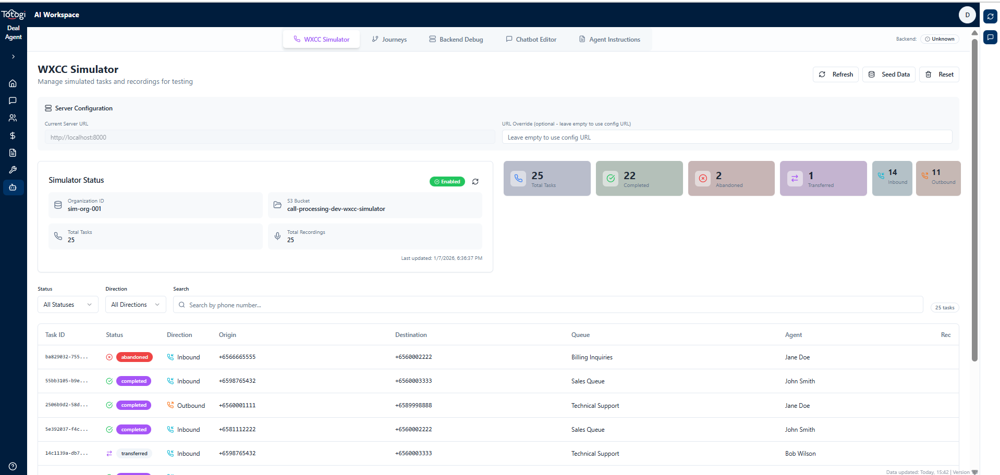
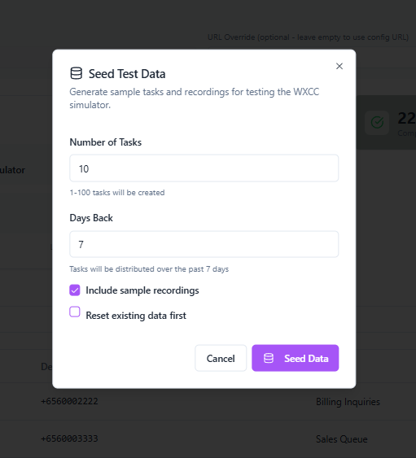
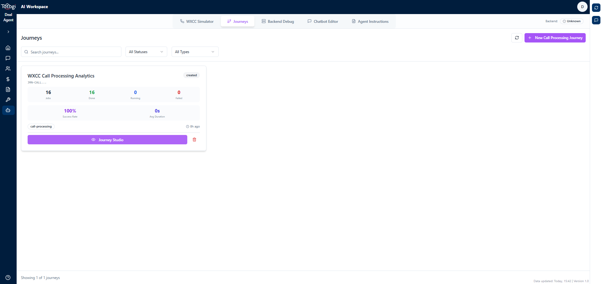
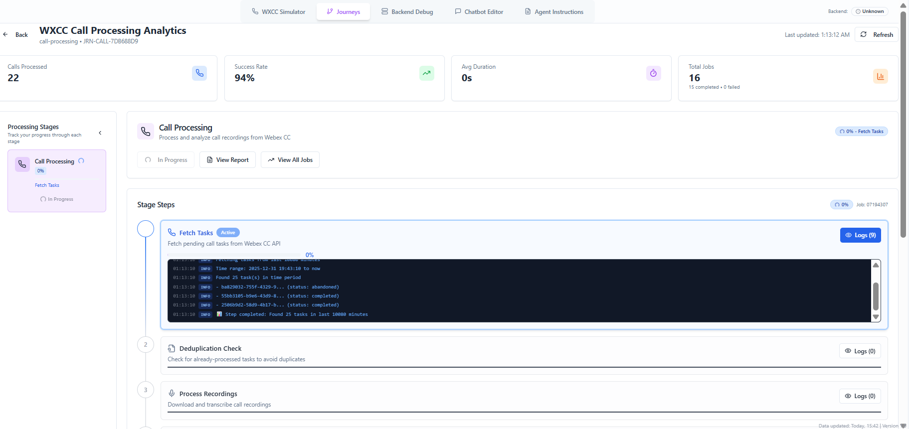

# Call Processing Developer Guide

A comprehensive guide for developers working with the Call Processing transformation job in the AI Job Engine.

---

## Table of Contents

1. [Architecture Overview](#architecture-overview)
2. [Component Structure](#component-structure)
3. [Code Deep Dive](#code-deep-dive)
4. [Making Changes](#making-changes)
5. [Configuration](#configuration)
6. [Testing Strategies](#testing-strategies)
7. [Using the WXCC Simulator](#using-the-wxcc-simulator)
8. [Testing via UI (Journey Studio)](#testing-via-ui-journey-studio)
9. [CLI Testing & Scripts](#cli-testing--scripts)
10. [Troubleshooting](#troubleshooting)

---

## Architecture Overview

The Call Processing Stage is a transformation job that processes Webex Contact Center (WXCC) calls through a 6-step pipeline:

```
┌─────────────────────────────────────────────────────────────────────────────┐
│                        CALL PROCESSING PIPELINE                             │
├─────────────────────────────────────────────────────────────────────────────┤
│                                                                             │
│  Webex CC API   ──►  Fetch Tasks   ──►  Deduplicate  ──►  Process Recordings│
│                                                                             │
│                      Register Metadata  ◄──  Transcribe  ◄──┘               │
│                             │                                               │
│                             ▼                                               │
│                      AI Analysis   ──►   S3 + Glue Catalog                  │
│                             │                                               │
│                             ▼                                               │
│                      CRM Actions   ──►   Salesforce (Leads/Opportunities)   │
│                                                                             │
└─────────────────────────────────────────────────────────────────────────────┘
```

### Pipeline Steps

| Step | Name | Description | Duration |
|------|------|-------------|----------|
| 1 | **Fetch Tasks** | Query Webex CC for telephony tasks in time window | ~1m |
| 2 | **Deduplication** | Check DynamoDB for previously processed task IDs | ~30s |
| 3 | **Process Recordings** | Download recordings, transcribe, upload to S3 | ~5m |
| 4 | **Register Metadata** | Create JSON metadata, register Glue partitions | ~1m |
| 5 | **AI Analysis** | Run GPT analysis on transcripts, store results | ~3m |
| 6 | **CRM Actions** | Create/update Salesforce leads and opportunities | ~2m |

### Integration with AI Job Engine

The Call Processing Stage integrates with the AI Job Engine through:

```
┌──────────────────────────────────────────────────────────────────┐
│                     Job Execution Lifecycle                       │
└──────────────────────────────────────────────────────────────────┘

User/UI Trigger → TransformationJobExecutor.start_job_execution()
                         │
                         ▼
              Generate Job ID (JOB-001-20260108120000)
                         │
                         ▼
              Create job record in DynamoDB
                         │
                         ▼
              Load CallProcessStage class
                         │
                         ▼
              Execute each step sequentially
                         │
                         ├── Step completion → Upload logs to S3
                         ├── Step completion → Upload report to S3
                         └── Step completion → Update DynamoDB progress
                         │
                         ▼
              Complete job (100% progress)
```

---

## Component Structure

### Directory Layout

```
src/stages/call-process/
├── __init__.py              # Package exports (CallProcessStage)
├── call_process_stage.py    # Stage wrapper for journey integration
└── call_processor.py        # Core processing logic

scripts/call-scripts/
├── ai_analyzer.py           # GPT-powered call analysis
├── sfdc_client.py           # Salesforce API integration
├── task_tracker.py          # DynamoDB deduplication
├── wxcc_api.py              # Webex CC API client
├── transcriber.py           # Audio transcription
├── glue_catalog.py          # AWS Glue registration
├── secrets_provider.py      # Secrets management
├── process_calls.py         # Standalone CLI script
├── setup_glue.py            # Glue table setup
└── clean_glue_data.py       # Data cleanup utility

scripts/wxcc-simulator/
├── seed_simulator.py        # Simulator seeding script
└── recordings/              # Sample audio files
```

### Class Hierarchy

```
┌─────────────────────────────────────────────────────────────────────────────┐
│                        COMPONENT ARCHITECTURE                               │
├─────────────────────────────────────────────────────────────────────────────┤
│                                                                             │
│   ┌─────────────────────────────────────────────────────────────────────┐   │
│   │                        CallProcessStage                             │   │
│   │  (extends BaseStage for journey integration)                        │   │
│   │                                                                     │   │
│   │  • execute_step(step_id, step_data)                                 │   │
│   │  • Logging & metrics via BaseStage                                  │   │
│   │  • S3 log/report upload                                             │   │
│   └────────────────────────────────┬────────────────────────────────────┘   │
│                                    │                                        │
│                                    │ uses                                   │
│                                    ▼                                        │
│   ┌─────────────────────────────────────────────────────────────────────┐   │
│   │                        CallProcessor                                │   │
│   │  (core processing logic)                                            │   │
│   │                                                                     │   │
│   │  • fetch_tasks()                                                    │   │
│   │  • check_deduplication()                                            │   │
│   │  • process_recordings()                                             │   │
│   │  • register_metadata()                                              │   │
│   │  • run_ai_analysis()                                                │   │
│   │  • run_crm_actions()                                                │   │
│   │  • generate_execution_report()                                      │   │
│   └────────────────────────────────┬────────────────────────────────────┘   │
│                                    │                                        │
│          ┌─────────────────────────┼─────────────────────────┐              │
│          │                         │                         │              │
│          ▼                         ▼                         ▼              │
│   ┌────────────────┐     ┌────────────────┐       ┌────────────────┐        │
│   │    WXCCAPI     │     │  TaskTracker   │       │   AIAnalyzer   │        │
│   │ (Webex CC API) │     │  (DynamoDB)    │       │  (OpenAI GPT)  │        │
│   └────────────────┘     └────────────────┘       └────────────────┘        │
│                                                                             │
│                                    │                                        │
│                                    ▼                                        │
│                         ┌────────────────────┐                              │
│                         │   SFDCClient       │                              │
│                         │  (Salesforce API)  │                              │
│                         └────────────────────┘                              │
│                                                                             │
└─────────────────────────────────────────────────────────────────────────────┘
```

---

## Code Deep Dive

### CallProcessStage (Stage Wrapper)

**File:** `src/stages/call-process/call_process_stage.py`

This class extends `BaseStage` and provides the journey integration layer:

```python
class CallProcessStage(BaseStage):
    """
    Call Processing Stage for Webex CC call analytics.
    
    This stage processes calls from Webex Contact Center by:
    - Fetching tasks for a specified time period
    - Checking for already-processed tasks (deduplication)
    - Downloading and transcribing recordings
    - Uploading to S3 and registering in Glue catalog
    - Running AI-powered analysis on transcripts
    - Creating/updating Salesforce CRM records
    """
```

**Key Properties:**

| Property | Type | Description |
|----------|------|-------------|
| `stage_name` | str | "Call Processing" |
| `stage_description` | str | Human-readable description |
| `steps` | List[Dict] | List of 6 step definitions |

**Key Methods:**

| Method | Purpose |
|--------|---------|
| `execute_step(step_id, step_data)` | Main entry point for step execution |
| `_ensure_processor(step_data)` | Lazy initialization of CallProcessor |
| `_execute_fetch_tasks(step_data)` | Execute Step 1 |
| `_execute_deduplication(step_data)` | Execute Step 2 |
| `_execute_process_recordings(step_data)` | Execute Step 3 |
| `_execute_register_metadata(step_data)` | Execute Step 4 |
| `_execute_ai_analysis(step_data)` | Execute Step 5 |
| `_execute_crm_actions(step_data)` | Execute Step 6 |

### CallProcessor (Core Logic)

**File:** `src/stages/call-process/call_processor.py`

This class contains all the business logic:

```python
class CallProcessor:
    """
    Core call processing logic.
    
    This class provides methods for each step of the call processing workflow:
    1. Fetch tasks from Webex CC
    2. Check for already-processed tasks (deduplication)
    3. Process recordings (download, transcribe, upload)
    4. Register metadata in Glue
    5. Run AI analysis on transcripts
    6. Execute CRM actions
    """
```

**State Management:**

The processor maintains state across steps:

```python
# Processing state
self.tasks = []                # Tasks from Webex CC
self.task_data_map = {}        # Task ID → Task data mapping
self.new_task_ids = []         # IDs of tasks to process
self.skipped_task_ids = []     # IDs of already-processed tasks
self.processed_results = []    # Successfully processed tasks
self.failed_results = []       # Failed tasks
self.transcripts = []          # Collected transcripts
self.analysis_results = {}     # AI analysis results

# CRM state
self.crm_results = []          # All CRM action results
self.leads_created = []        # Task IDs with created leads
self.leads_converted = []      # Task IDs with converted leads
```

### CallProcessConfig

**File:** `src/stages/call-process/call_processor.py`

Configuration dataclass:

```python
@dataclass
class CallProcessConfig:
    minutes_back: int = 10080      # 7 days (7 * 24 * 60)
    transcribe: bool = True        # Enable transcription
    register_glue: bool = True     # Enable Glue registration
    run_analysis: bool = True      # Enable AI analysis
    run_crm_actions: bool = True   # Enable CRM actions
    s3_bucket: str = ""            # S3 bucket for storage
    skip_processed: bool = True    # Enable deduplication
    aws_region: str = "ap-southeast-1"
```

---

## Making Changes

### Adding a New Processing Step

1. **Add step definition** in `CallProcessStage.steps`:

```python
@property
def steps(self) -> List[Dict[str, Any]]:
    return [
        # ... existing steps ...
        {
            'id': 'new_step',
            'name': 'New Step Name',
            'description': 'Description of what this step does',
            'order': 6,  # Increment as needed
            'estimatedDuration': '1m',
        },
    ]
```

2. **Add execution method** in `CallProcessStage`:

```python
def _execute_new_step(self, step_data: Dict[str, Any]) -> Dict[str, Any]:
    step_id = 'new_step'
    self._log_local('INFO', '🆕 Starting new step', step_id)
    
    result = self.processor.run_new_step()  # Call processor method
    
    # Set metrics
    self.set_metric('items_processed', result.get('count', 0), step_id)
    
    # Add artifacts
    self.add_artifact('step_output', result.get('data', {}), step_id)
    
    self._log_local('INFO', f"📊 Step completed: {result.get('summary', '')}", step_id)
    
    return result
```

3. **Add dispatch** in `execute_step`:

```python
def execute_step(self, step_id: str, step_data: Dict[str, Any]) -> Dict[str, Any]:
    # ... existing code ...
    elif step_id == 'new_step':
        result = self._execute_new_step(step_data)
```

4. **Implement core logic** in `CallProcessor`:

```python
def run_new_step(self) -> Dict[str, Any]:
    """
    Step N: Description of what this step does.
    
    Returns:
        Dict with step results
    """
    self._log('INFO', "Starting new step processing", 'new_step')
    
    # Your processing logic here
    
    return {
        'status': 'completed',
        'step_id': 'new_step',
        'summary': 'Step completed successfully',
        'count': len(items_processed)
    }
```

### Modifying AI Analysis

**File:** `scripts/call-scripts/ai_analyzer.py`

To change the AI analysis prompts or logic:

```python
class AIAnalyzer:
    async def analyze_call_comprehensive(
        self,
        segments: List[Dict],
        call_id: str,
        metadata: Dict = None
    ) -> Dict[str, Any]:
        """
        Run comprehensive analysis on a call transcript.
        
        Modify the system_prompt or user_prompt to change analysis behavior.
        """
```

### Modifying CRM Logic

**File:** `src/stages/call-process/call_processor.py`

CRM validation rules are in `_apply_crm_validation_rules`:

```python
def _apply_crm_validation_rules(self, crm_analysis: Dict[str, Any]) -> Dict[str, Any]:
    """
    Apply validation rules to determine appropriate CRM action.
    
    Decision Matrix:
    - new_lead: Valid company, BRN, qualified inquiry
    - lead_conversion: Transcript contains Lead ID (00Q...)
    - renewal_opportunity: Existing customer, no Lead ID
    - skip_revenue_flagged: Customer is revenue-flagged
    - skip_insufficient: Missing critical data
    - skip_consumer: Non-enterprise customer
    """
```

### Changing S3 Storage Structure

**File:** `scripts/call-scripts/wxcc_api.py`

S3 paths are defined in `process_task_unified`:

```python
# Current structure:
s3://{bucket}/
├── call-detail/{task_id}/
│   ├── recording.wav
│   ├── transcript.json
│   ├── analysis.json
│   └── sfdc_action.json
└── call-data/year={YYYY}/month={MM}/day={DD}/hour={HH}/
    └── {task_id}.json  # Glue-partitioned metadata
```

---

## Configuration

### Setting Up `.env.local` for Local Development

Create a `.env.local` file in the project root (`starhub-backend/.env.local`) with all required credentials.

#### Complete `.env.local` Template

```bash
# =============================================================================
# AWS Configuration
# =============================================================================

# AWS Region
AWS_REGION=ap-southeast-1

# Capability and Environment (used for naming convention)
CAPABILITY_NAME=call-processing
ENVIRONMENT=dev

# Secrets Backend (false = use local .env.local, true = use AWS Secrets Manager)
USE_AWS_SECRETS=false

# =============================================================================
# WEBEX CONTACT CENTER OAUTH CREDENTIALS
# =============================================================================
# To obtain these credentials:
# 1. Go to https://developer.webex.com/
# 2. Log in with your Webex account
# 3. Navigate to "My Webex Apps" → Create a New App → Integration
# 4. Select scopes: cjp:config_read, cjp:user_read, cjp:recording_read
# 5. Set Redirect URI to match your environment

# Webex OAuth Client ID (from Webex Developer Portal)
WEBEX_CLIENT_ID=C1234567890abcdef1234567890abcdef12345678

# Webex OAuth Client Secret (from Webex Developer Portal)
WEBEX_CLIENT_SECRET=abcdef1234567890abcdef1234567890abcdef1234567890abcdef1234567890

# OAuth Redirect URI (must match what's configured in Webex Developer Portal)
WEBEX_REDIRECT_URI=https://localhost:8000/callback

# WXCC Organization ID (your Webex Contact Center org)
# Find this in: Control Hub → Contact Center → Settings → General
WXCC_ORG_ID=12345678-abcd-1234-abcd-1234567890ab

# WXCC API Base URL (depends on your region)
#   US:  https://api.wxcc-us1.cisco.com/v1
#   EU:  https://api.wxcc-eu1.cisco.com/v1
#   ANZ: https://api.wxcc-anz1.cisco.com/v1
WXCC_BASE_URL=https://api.wxcc-us1.cisco.com/v1

# =============================================================================
# SALESFORCE OAUTH CREDENTIALS
# =============================================================================
# To obtain these credentials:
# 1. Go to Salesforce Setup → App Manager → New Connected App
# 2. Enable OAuth Settings
# 3. Select scopes: api, refresh_token, full
# 4. Save and note the Consumer Key (Client ID) and Consumer Secret

# Enable/disable Salesforce simulator mode
# Set to "true" for testing without real Salesforce, "false" for production
SFDC_SIMULATOR_ENABLED=true

# Salesforce Instance URL
# Production: https://login.salesforce.com
# Sandbox:    https://test.salesforce.com
# My Domain:  https://yourcompany.my.salesforce.com
SFDC_INSTANCE_URL=https://test.salesforce.com

# Salesforce API Version (check your org's supported versions)
SFDC_API_VERSION=v59.0

# Salesforce Connected App Client ID (Consumer Key)
SFDC_CLIENT_ID=3MVG9abcdefghijklmnopqrstuvwxyz1234567890

# Salesforce Connected App Client Secret (Consumer Secret)
SFDC_CLIENT_SECRET=ABCDEF1234567890ABCDEF1234567890

# Salesforce Username (the user that will make API calls)
SFDC_USERNAME=integration.user@yourcompany.com

# Salesforce Password
SFDC_PASSWORD=YourPassword123

# Salesforce Security Token (from User Settings → Reset Security Token)
# Append to password for authentication: password + security_token
SFDC_SECURITY_TOKEN=ABCDEFGHIJ1234567890

# =============================================================================
# OPENAI CONFIGURATION
# =============================================================================
# To obtain API key:
# 1. Go to https://platform.openai.com/
# 2. Navigate to API Keys → Create new secret key

# OpenAI API Key (required for transcription and AI analysis)
OPENAI_API_KEY=sk-proj-1234567890abcdefghijklmnopqrstuvwxyz

# Transcription model
OPENAI_TRANSCRIPTION_MODEL=gpt-4o-transcribe

# =============================================================================
# S3 STORAGE CONFIGURATION
# =============================================================================

# S3 bucket for storing recordings, transcripts, and metadata
S3_RECORDINGS_BUCKET=call-processing-dev-recordings

# S3 prefixes (usually don't need to change)
S3_CALL_DATA_PREFIX=call-data/
S3_CALL_DETAIL_PREFIX=call-detail/

# =============================================================================
# AWS GLUE CONFIGURATION
# =============================================================================

# Glue database name for analytics
GLUE_DATABASE_NAME=call-processing-dev-wxcc-analytics

# Glue table name
GLUE_TABLE_NAME=calls

# =============================================================================
# DYNAMODB TASK TRACKING
# =============================================================================

# DynamoDB table for deduplication tracking
DYNAMODB_TRACKING_TABLE=call-processing-dev-wxcc-task-tracking

# Task record TTL in days
TASK_TRACKING_TTL_DAYS=30

# =============================================================================
# WXCC SIMULATOR CONFIGURATION (for testing)
# =============================================================================

# Enable simulator mode (bypasses real Webex API)
WXCC_SIMULATOR_ENABLED=true

# Simulator API URL
WXCC_SIMULATOR_BASE_URL=http://localhost:8000/api/v1/simulator

# Simulator credentials (fixed values for testing)
WXCC_SIM_ORG_ID=sim-org-001
WXCC_SIM_TOKEN=test-token-12345
WXCC_SIMULATOR_BUCKET=call-processing-dev-recordings
WXCC_SIMULATOR_PREFIX=wxcc-simulator

# =============================================================================
# LOGGING
# =============================================================================

LOG_LEVEL=INFO
```

---

### Obtaining Webex CC OAuth Credentials

#### Step 1: Create a Webex Integration

1. Navigate to [Webex Developer Portal](https://developer.webex.com/)
2. Sign in with your Webex account (must have Contact Center admin access)
3. Go to **My Webex Apps** → **Create a New App** → **Create an Integration**

#### Step 2: Configure OAuth Scopes

Select the following scopes:

| Scope | Description |
|-------|-------------|
| `cjp:config_read` | Read Contact Center configuration |
| `cjp:user_read` | Read user/agent information |
| `cjp:recording_read` | Access call recordings |
| `cjp:analyzer_read` | Read analytics data |

#### Step 3: Set Redirect URI

- For local development: `http://localhost:8000/callback`
- For production: Your actual callback URL

#### Step 4: Save Credentials

After creating the integration, note down:

- **Client ID**: `WEBEX_CLIENT_ID`
- **Client Secret**: `WEBEX_CLIENT_SECRET`
- **Redirect URI**: `WEBEX_REDIRECT_URI`

#### Step 5: Get Organization ID

1. Log in to [Webex Control Hub](https://admin.webex.com/)
2. Navigate to **Contact Center** → **Settings** → **General**
3. Copy the **Organization ID**: `WXCC_ORG_ID`

#### Step 6: Create `tokens.json`

Create a `tokens.json` file in `scripts/call-scripts/` with your OAuth tokens:

```json
{
  "access_token": "your_access_token_here",
  "refresh_token": "your_refresh_token_here",
  "expires_at": 1704672000,
  "expires_in": 43199,
  "token_type": "Bearer"
}
```

> **Note:** You can obtain initial tokens by running the OAuth flow manually or using the Webex Developer Portal's "Try It" feature.

---

### Obtaining Salesforce OAuth Credentials

#### Step 1: Create a Connected App

1. Log in to Salesforce Setup
2. Navigate to **App Manager** → **New Connected App**
3. Fill in:
   - **Connected App Name**: `Call Processing Integration`
   - **API Name**: `Call_Processing_Integration`
   - **Contact Email**: Your email

#### Step 2: Enable OAuth Settings

1. Check **Enable OAuth Settings**
2. Set **Callback URL**: `https://localhost:8000/callback` (or your callback)
3. Select **OAuth Scopes**:
   - `api` - Access and manage your data
   - `refresh_token` - Perform requests at any time
   - `full` - Full access to your data

#### Step 3: Save and Get Credentials

After saving:

1. **Consumer Key** → `SFDC_CLIENT_ID`
2. **Consumer Secret** → `SFDC_CLIENT_SECRET` (click to reveal)

#### Step 4: Get Security Token

1. Go to **User Settings** → **Reset My Security Token**
2. Check your email for the new token
3. Use this as `SFDC_SECURITY_TOKEN`

#### Salesforce Authentication Flow

For username-password OAuth flow, the password sent is: `password + security_token`

```bash
# Example authentication (for testing)
curl -X POST https://login.salesforce.com/services/oauth2/token \
  -d "grant_type=password" \
  -d "client_id=${SFDC_CLIENT_ID}" \
  -d "client_secret=${SFDC_CLIENT_SECRET}" \
  -d "username=${SFDC_USERNAME}" \
  -d "password=${SFDC_PASSWORD}${SFDC_SECURITY_TOKEN}"
```

---

### Environment Variables Reference

| Variable | Description | Default |
|----------|-------------|---------|
| `AWS_REGION` | AWS region | `ap-southeast-1` |
| `S3_RECORDINGS_BUCKET` | S3 bucket for recordings | Required |
| `GLUE_DATABASE_NAME` | Glue database name | `{capability}-{env}-wxcc-analytics` |
| `GLUE_TABLE_NAME` | Glue table name | `calls` |
| `OPENAI_API_KEY` | OpenAI API key | Required for analysis |
| `WXCC_SIMULATOR_ENABLED` | Enable WXCC simulator | `false` |
| `WXCC_SIMULATOR_BASE_URL` | Simulator URL | `http://localhost:8000/api/v1/simulator` |
| `SFDC_SIMULATOR_ENABLED` | Enable SFDC simulator | `true` |
| `SFDC_INSTANCE_URL` | Salesforce login URL | `https://login.salesforce.com` |

---

### Using Simulator Mode (Recommended for Development)

For local development without real Webex/Salesforce credentials, enable simulator mode:

```bash
# .env.local - Simulator Mode Configuration
WXCC_SIMULATOR_ENABLED=true
SFDC_SIMULATOR_ENABLED=true
```

This allows you to:
- Test the full pipeline without real API credentials
- Generate mock call data with the simulator seeder
- Validate CRM logic without affecting real Salesforce data

---

### Config Provider

The `config_provider.py` centralizes all configuration:

```python
from src.config.config_provider import get_config

config = get_config()
print(config.s3_recordings_bucket)
print(config.openai_api_key)
```

### Step Configuration via Journey Metadata

Pass configuration in step_data when executing:

```python
step_data = {
    'config': {
        'minutes_back': 10080,      # 7 days
        'transcribe': True,
        'register_glue': True,
        'run_analysis': True,
        'run_crm_actions': True,
        's3_bucket': 'my-bucket',
        'skip_processed': True,
    }
}
```

---

## Testing Strategies

### Test Levels

```
┌─────────────────────────────────────────────────────────────────┐
│                     TESTING PYRAMID                             │
├─────────────────────────────────────────────────────────────────┤
│                                                                 │
│                    ┌───────────────┐                            │
│                    │    E2E/UI     │  Journey Studio Tests      │
│                    │    Tests      │                            │
│                    └───────┬───────┘                            │
│                            │                                    │
│               ┌────────────┴────────────┐                       │
│               │    Integration Tests    │  CLI + Simulator      │
│               │    (with Simulator)     │                       │
│               └────────────┬────────────┘                       │
│                            │                                    │
│        ┌───────────────────┴───────────────────┐                │
│        │           Unit Tests                  │  pytest        │
│        │      (mocked dependencies)            │                │
│        └───────────────────────────────────────┘                │
│                                                                 │
└─────────────────────────────────────────────────────────────────┘
```

### Unit Tests

```bash
# Run all call processing tests
pytest tests/unit/call_process/ -v

# Run with coverage
pytest tests/unit/call_process/ -v --cov=src/stages/call-process
```

### Integration Tests

```bash
# Run live call processing test (requires AWS credentials and WXCC)
pytest tests/integration/call_process/test_live_call_processing.py -v --run-live
```

---

## Using the WXCC Simulator

The WXCC Simulator provides a mock Webex Contact Center API for local development and testing.

### Setup

1. **Ensure the backend server is running:**

```bash
cd starhub-backend
python -m uvicorn src.main:app --host 0.0.0.0 --port 8000
```

2. **Seed the simulator with test data:**

```bash
# Seed with 2 tasks using current time (for immediate testing)
python scripts/wxcc-simulator/seed_simulator.py --api http://localhost:8000 --tasks 2 --reset --now

# Seed with 10 tasks spread over 7 days
python scripts/wxcc-simulator/seed_simulator.py --api http://localhost:8000 --tasks 10 --days 7 --reset
```

### Simulator Commands

| Command | Purpose |
|---------|---------|
| `--api URL` | Gateway URL (e.g., `http://localhost:8000`) |
| `--tasks N` | Number of tasks to create |
| `--days N` | Spread tasks over N days |
| `--reset` | Clear existing data before seeding |
| `--now` | Create tasks with current timestamp |
| `--status` | Show simulator status |

### Simulator Dashboard

The simulator provides a dashboard showing all seeded tasks and their status:



*The Simulator Dashboard displays:*
- *Total tasks in the simulator*
- *Task status breakdown (completed, abandoned, transferred)*
- *Recording availability for each task*

### Seeding the Simulator

When you run the seed command, you'll see detailed output:



*The seeding process shows:*
- *Configuration used (tasks, days, recordings)*
- *Tasks created with their IDs and status*
- *Final simulator state summary*

### Simulator API Endpoints

| Endpoint | Method | Description |
|----------|--------|-------------|
| `/api/v1/simulator/status` | GET | Get simulator status |
| `/api/v1/simulator/seed` | POST | Seed simulator with data |
| `/api/v1/simulator/reset` | POST | Reset simulator data |
| `/api/v1/simulator/tasks` | GET | Get tasks (WXCC-compatible) |

---

## Testing via UI (Journey Studio)

### Prerequisites

1. Backend server running on port 8000
2. Frontend (starhub-ui) running on port 3000
3. A Call Processing journey created in the system

### Step 1: Seed the Simulator with Test Data

Before running the Call Processing job, seed the simulator (see [Using the WXCC Simulator](#using-the-wxcc-simulator) section for screenshots):

```bash
python scripts/wxcc-simulator/seed_simulator.py --api http://localhost:8000 --tasks 2 --reset --now
```

### Step 2: Access Journey Studio

Navigate to Journey Studio and select your Call Processing journey:



*The Journey Studio shows all stages in your journey. The Call Processing stage appears with its 6 steps.*

### Step 3: Execute the Call Processing Job

In Journey Studio, click "Run Job" on the Call Processing stage:



*The UI shows real-time progress as each step executes. You can see:*
- *Step status (pending → in_progress → completed)*
- *Progress percentage*
- *Duration of each step*
- *Step-by-step execution logs*
- *Task processing status*
- *Metrics and statistics*
- *Error messages (if any)*

### Interpreting Results

| Metric | Description |
|--------|-------------|
| Tasks Found | Total tasks in time window |
| New Tasks | Tasks not previously processed |
| Skipped | Already-processed tasks |
| Processed | Successfully processed tasks |
| Failed | Tasks with errors |
| Transcripts | Collected transcripts |
| Analyzed | Calls with AI analysis |
| Leads Created | New Salesforce leads |

---

## CLI Testing & Scripts

### Complete Testing Workflow

Run these commands in sequence for a full end-to-end test:

```bash
# 1. Setup Glue infrastructure (first time only)
python scripts/call-scripts/setup_glue.py --delete-table 
python scripts/call-scripts/setup_glue.py --create-glue

# 2. Clean existing data (optional - for fresh start)
python scripts/call-scripts/clean_glue_data.py --clean --force --reset-tracker

# 3. Seed the simulator with test tasks
python scripts/wxcc-simulator/seed_simulator.py --api http://localhost:8000 --tasks 2 --reset --now

# 4. Run call processing (standalone CLI)
python scripts/call-scripts/process_calls.py --minutes 10080 --analyze --crm-action

# 5. Run via Job Engine (recommended)
./run_transformation_job.py --journey-id JRN-CALL-7DB688D9 --stage-id call_process
```

### Script Reference

#### setup_glue.py

```bash
# Create Glue database and table
python scripts/call-scripts/setup_glue.py --create-glue

# Delete existing table
python scripts/call-scripts/setup_glue.py --delete-table

# Show status
python scripts/call-scripts/setup_glue.py --status
```

#### clean_glue_data.py

```bash
# Clean S3 data and reset tracker
python scripts/call-scripts/clean_glue_data.py --clean --force --reset-tracker

# Preview what would be cleaned
python scripts/call-scripts/clean_glue_data.py --dry-run
```

#### process_calls.py (Standalone)

```bash
# Process calls from last 7 days with AI analysis
python scripts/call-scripts/process_calls.py --minutes 10080 --analyze

# Process with CRM actions
python scripts/call-scripts/process_calls.py --minutes 10080 --analyze --crm-action

# Dry run (show what would be processed)
python scripts/call-scripts/process_calls.py --dry-run

# Force reprocess (ignore deduplication)
python scripts/call-scripts/process_calls.py --force

# Show status only
python scripts/call-scripts/process_calls.py --status
```

#### run_transformation_job.py (Job Engine)

```bash
# Run via job engine (creates job record, updates DynamoDB, uploads logs)
./scripts/journey-scripts/run_transformation_job.py \
    --journey-id JRN-CALL-7DB688D9 \
    --stage-id call_process \
    --triggered-by developer \
    --reason "Testing call processing"
```

### Integration Tests

```bash
# Run the live integration test
pytest tests/integration/call_process/test_live_call_processing.py -v --run-live

# Run with verbose output
pytest tests/integration/call_process/test_live_call_processing.py -v --run-live -s
```

---

## Troubleshooting

### Common Issues

#### 1. "WXCC imports not available"

**Cause:** The `scripts/call-scripts` path is not in Python path.

**Solution:**
```python
# Ensure this is at the top of your script
import sys
sys.path.insert(0, 'scripts/call-scripts')
```

#### 2. "No tasks found"

**Cause:** Simulator not seeded or time window doesn't match.

**Solution:**
```bash
# Seed with --now flag for current timestamp
python scripts/wxcc-simulator/seed_simulator.py --api http://localhost:8000 --tasks 5 --reset --now
```

#### 3. "AI analyzer not available"

**Cause:** Missing OpenAI API key.

**Solution:**
```bash
export OPENAI_API_KEY="your-api-key"
```

#### 4. "SFDC client not available"

**Cause:** Salesforce credentials not configured.

**Solution:** Check `secrets_provider.py` and ensure SFDC credentials are in AWS Secrets Manager.

#### 5. Job stuck at 0% progress

**Cause:** Step execution error before progress update.

**Solution:** Check logs:
```bash
# View local logs
cat logs/call_process_*.log

# View S3 logs
aws s3 ls s3://{bucket}/journeys/{journey-id}/stages/call_process/executions/{job-id}/logs/
```

### Debug Mode

Enable verbose logging:

```python
# In CallProcessor
self.log_callback = lambda level, msg, step_id=None: print(f"[{level}] {step_id}: {msg}")
```

### Log Files

| Location | Content |
|----------|---------|
| `logs/call_process_{job_id}_{timestamp}.log` | Local execution logs |
| `s3://{bucket}/journeys/.../logs/{step_id}.json` | Per-step logs |
| `s3://{bucket}/journeys/.../reports/{step_id}.json` | Per-step reports |

---

## External Dependencies

| Component | Purpose | Documentation |
|-----------|---------|---------------|
| Webex CC API | Source of call tasks and recordings | [Webex API Docs](https://developer.webex.com) |
| AWS S3 | Storage for recordings, transcripts, metadata | [S3 Docs](https://docs.aws.amazon.com/s3/) |
| AWS Glue | Data catalog for analytics | [Glue Docs](https://docs.aws.amazon.com/glue/) |
| AWS Athena | Query engine for Glue tables | [Athena Docs](https://docs.aws.amazon.com/athena/) |
| DynamoDB | Task deduplication tracking | [DynamoDB Docs](https://docs.aws.amazon.com/dynamodb/) |
| OpenAI GPT | AI-powered call analysis | [OpenAI Docs](https://platform.openai.com/docs/) |
| Salesforce API | Lead and opportunity management | [Salesforce Docs](https://developer.salesforce.com) |

---

## Quick Reference

### File Locations

| Purpose | File |
|---------|------|
| Stage wrapper | `src/stages/call-process/call_process_stage.py` |
| Core logic | `src/stages/call-process/call_processor.py` |
| Base stage | `src/stages/base_stage.py` |
| Job executor | `src/utils/job_executor.py` |
| Webex API | `scripts/call-scripts/wxcc_api.py` |
| AI analyzer | `scripts/call-scripts/ai_analyzer.py` |
| SFDC client | `scripts/call-scripts/sfdc_client.py` |
| Simulator seeder | `scripts/wxcc-simulator/seed_simulator.py` |

### Key Commands

```bash
# Setup
python scripts/call-scripts/setup_glue.py --create-glue

# Seed simulator
python scripts/wxcc-simulator/seed_simulator.py --api http://localhost:8000 --tasks 2 --reset --now

# Run processing
python scripts/call-scripts/process_calls.py --minutes 10080 --analyze --crm-action

# Run via job engine
./scripts/journey-scripts/run_transformation_job.py --journey-id JRN-CALL-xxx --stage-id call_process

# Run tests
pytest tests/integration/call_process/test_live_call_processing.py -v --run-live
```

---

## Changelog

| Date | Version | Changes |
|------|---------|---------|
| 2026-01-08 | 1.0.0 | Initial developer guide |

---

*Last updated: January 8, 2026*
