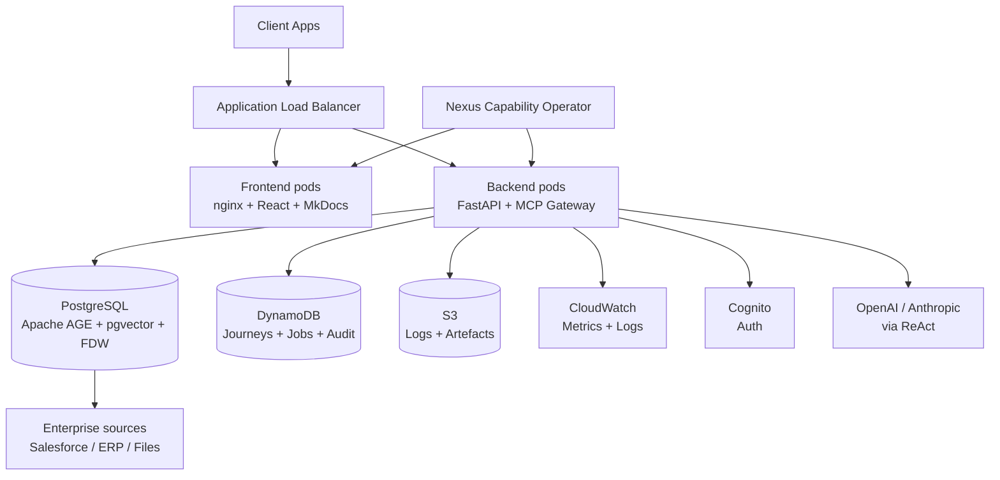

---
hide:
  - toc
---

# Technical Documentation

In-depth engineering reference for the NexusAI Data-AI Platform: solution architecture, infrastructure, the unified gateway, the job execution engine, database design, observability, and EKS hardening.

## In this section

| Topic | Page |
|---|---|
| End-to-end solution architecture (frontend, backend, databases, integrations) | [Solution Architecture](solution-architecture.md) |
| AWS resources, env vars, networking, IAM | [Infrastructure Requirements](INFRASTRUCTURE_REQUIREMENTS.md) |
| MCP HTTP gateway -- worker pool, REST surface | [Unified Gateway Guide](gateway/UNIFIED_GATEWAY_GUIDE.md) |
| Journey / job lifecycle in the AI Job Engine | [Job Execution Flow](architecture/job-execution-flow.md) |
| `TransformationSystem` single-table DynamoDB design for journeys / jobs | [Journey Data](dbdesign/journey-data.md) |
| `BusinessCapabilitySystem` DynamoDB model for the capability catalogue | [Capability Data](dbdesign/capability-data.md) |
| DynamoDB throughput, costs, hot-key analysis | [DynamoDB Operations Analysis](dynamodb-operations-analysis.md) |
| CloudWatch log volumes, retention, cost | [CloudWatch Logs Analysis](cloudwatch-logs-analysis.md) |
| EKS hardening (CIS compliance, hardened nodes) | [EKS Hardening](eks-hardening/README.md) |

## High-level architecture

## Technology stack

| Layer | Choice |
|---|---|
| Frontend | React + TypeScript, Vite, Tailwind CSS, shadcn/ui |
| Backend | Python 3.11+, FastAPI, MCP HTTP Gateway |
| Database | PostgreSQL with Apache AGE (Knowledge Graph) + pgvector (embeddings) |
| Data integration | PostgreSQL FDW (Multicorn / Trino / Presto), ETL pipelines, CDC (Debezium / Kafka) |
| AI / LLM | OpenAI / Anthropic via the ReAct agent loop |
| Infrastructure | AWS EKS, ECR, S3, CloudWatch, Cognito |
| Orchestration | Nexus Capability Operator (`NexusCapability` CRD) |
| CI/CD | GitHub Actions, Docker, Helm |

## Operational baseline

- **REST APIs** -- `/api/v1/control-plane/*` (RAG / agent / index / stats / tools), `/api/v1/journeys/*`, `/api/fdw/*`, `/health`.
- **MCP tools** -- `journeys_tool`, `run_jobs_tool`, `logs_and_reports_tool`, plus the per-Solution tool registry.
- **Identity** -- Cognito SSO + session cookies; role-based access enforced at every plane.
- **Audit** -- DynamoDB table `control-plane-audit` records every agent step, tool call, and policy violation.

## Related references

- [Platform Architecture](../platform-architecture.md) -- system overview, screen-by-screen tour, and capability summary.
- [Implementation Guide](../ai-os/implementation-guide.md) -- production code paths (`nexus-backend`, `nexus-ui`, BSSMagic, FDW, pgvector).
- [AI Operating System](../ai-os/architecture.md) -- conceptual reference for Planes, ReAct, and Semantic RAG.
- [Operations](../operational/index.md) -- day-2 operations and the K8s Operator.
