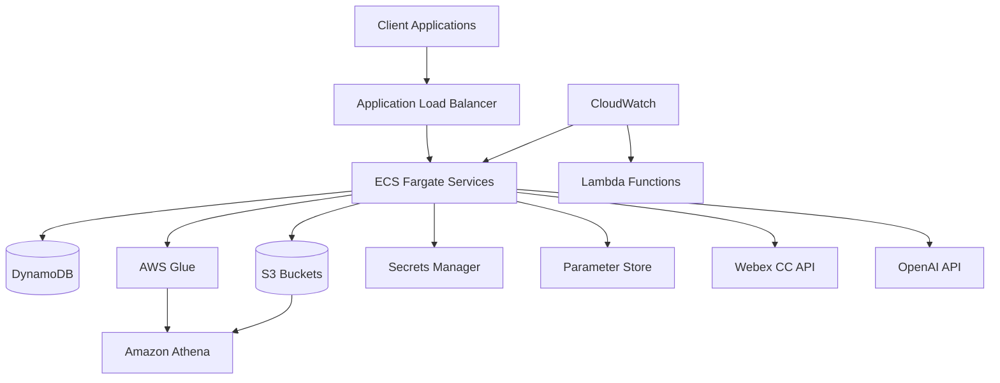

# Technical Documentation

This section provides in-depth technical documentation covering solution architecture, infrastructure requirements, integration guides, and system design.

## Overview

The technical documentation includes:

- **Solution Architecture** - High-level system design and architecture
- **Infrastructure Requirements** - AWS resources and configuration
- **Integration Guides** - Third-party system integration
- **Database Design** - Data models and schema
- **API Documentation** - REST APIs and MCP tools
- **Gateway Architecture** - HTTP gateway and MCP server

## Available Documents

### Solution Architecture
Comprehensive solution architecture document covering the entire platform design, components, and interactions.

📄 [View Solution Architecture](solution-architecture.md)

---

### Infrastructure Requirements
Detailed AWS infrastructure requirements including services, configurations, and best practices.

📄 [View Infrastructure Requirements](INFRASTRUCTURE_REQUIREMENTS.md)

---

### Integration Documentation

#### Webex Contact Center Integration
Complete guide for integrating with Webex Contact Center APIs.

📄 [View Webex Integration Guide](integration/webex-integration.md)

#### Implementation Questions
Key questions and answers about Webex CC implementation.

📄 [View Implementation Questions](integration/webex-implementation-questions.md)

#### Call Recording Pseudocode
Detailed pseudocode for call recording processing algorithms.

📄 [View Call Recording Pseudocode](integration/call-recording-pseudocode.md)

---

## System Architecture

### High-Level Architecture

### Component Architecture

The platform consists of several key components:

#### Backend Services
- **Gateway Service** - HTTP API gateway and MCP server
- **Call Processing Service** - Handles call recording processing
- **Journey Service** - Manages multi-stage workflows
- **License Service** - Enterprise licensing management
- **Analytics Service** - Real-time analytics and reporting

#### Storage Layer
- **DynamoDB Tables** - Transformation system, license, WXCC tracking
- **S3 Buckets** - Call recordings, logs, simulator data
- **AWS Glue** - Analytics database and ETL

#### Integration Layer
- **Webex CC API** - Call and task retrieval
- **OpenAI API** - Transcription and analysis
- **AWS Services** - Native AWS integrations

## Technical Specifications

### Programming Languages
- **Backend**: Python 3.11+
- **Frontend**: TypeScript, React
- **Infrastructure**: Terraform (HCL)
- **Scripts**: Bash, Python

### Frameworks & Libraries
- **FastAPI** - REST API framework
- **Pydantic** - Data validation
- **Boto3** - AWS SDK
- **OpenAI SDK** - AI capabilities
- **React** - Frontend framework

### AWS Services

#### Compute
- **ECS Fargate** - Containerized services
- **Lambda** - Serverless functions

#### Storage
- **S3** - Object storage
- **DynamoDB** - NoSQL database
- **EFS** - File storage (optional)

#### Analytics
- **AWS Glue** - Data catalog and ETL
- **Amazon Athena** - SQL queries on S3
- **CloudWatch** - Logs and metrics

#### Security
- **IAM** - Access management
- **Secrets Manager** - Secrets storage
- **Parameter Store** - Configuration
- **VPC** - Network isolation

### API Endpoints

#### REST APIs
- `/api/v1/journeys/*` - Journey management
- `/api/v1/license/*` - License operations
- `/api/v1/simulator/*` - WXCC simulator
- `/api/v1/analytics/*` - Analytics queries
- `/health` - Health check

#### MCP Tools
- `journeys_tool` - Journey operations
- `logs_and_reports_tool` - Logging and reports
- `wxcc_simulator_tool` - Simulator control
- `license_tool` - License management

## Development Environments

### LocalStack
Local AWS emulation for development:
- No AWS costs
- Rapid development cycle
- Isolated testing
- Full feature parity

### Real AWS
Production and staging environments:
- ECS deployment
- IAM role-based access
- SSM/Secrets Manager config
- CloudWatch monitoring

## Database Design

### DynamoDB Tables

#### Transformation System Table
Stores journey, stage, and job execution data.

#### License Table
Manages enterprise licenses and subscriptions.

#### WXCC Tracking Table
Tracks processed Webex CC calls to prevent duplication.

### AWS Glue Database
Analytics database with tables for:
- Call metadata
- Transcripts
- Analysis results
- Journey execution logs

## Security Architecture

### Authentication & Authorization
- API key authentication for gateway
- IAM role-based access for AWS services
- Cognito integration (optional)
- License key validation

### Data Security
- Encryption at rest (S3, DynamoDB)
- Encryption in transit (TLS)
- Secrets Manager for sensitive data
- VPC isolation

### Compliance
- AWS Well-Architected Framework
- SOC 2 considerations
- GDPR compliance support
- Data retention policies

---

## Additional Resources

- [Architecture Documentation](architecture/job-execution-flow.md)
- [Call Processing Details](call-processing/)
- [Gateway Documentation](gateway/)
- [Database Design](dbdesign/journey-data.md)

---

[← Back to Home](../index.md) | [← Previous: Project Scope](../project-scope/index.md) | [Next: Operational Documentation →](../operational/index.md)
