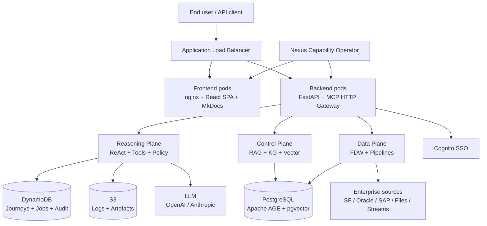

# Solution Architecture -- NexusAI Data-AI Platform

End-to-end engineering reference for how the platform is built and deployed. For the user-facing surface and screen-by-screen tour, see [Platform Architecture](../platform-architecture.md). For the production code-to-architecture mapping, see [Implementation Guide](../ai-os/implementation-guide.md).

## High-level architecture

## Layers

### 1. Presentation -- `nexus-ui`

- React + TypeScript + Vite + Tailwind CSS + shadcn/ui.
- Single-page app served by nginx.
- Surfaces: Home / Platform Architecture, the three Planes, the Console (Solutions Catalogue, AI Analytics, AI Automation, AI Ops), every Solution app workspace.
- Auth via Cognito SSO + session cookies; role-based access enforced at every page.

### 2. Application services -- `nexus-backend`

Python 3.11+ on FastAPI + MCP HTTP Gateway. Organised by plane:

- **Data Plane services** -- `fdw_discovery_service`, `fdw_query_service`, `bssmagic_crm_service`, Mapping Rule resolution, Data Pipeline runtime.
- **Control Plane services** -- `embedding_service`, `vector_store`, `schema_indexer`, `rag_service`, Knowledge Pipeline orchestrator, Policy / Workflow / Integration editors backend.
- **Reasoning Plane services** -- `agent_executor` (ReAct loop), `policy_engine`, `tool_registry` + tools, `intent_analyzer`, `audit_logger`.
- **Console APIs** -- `/api/v1/control-plane/*`, `/api/fdw/*`, `/api/v1/journeys/*`, `/api/v1/sfdc-simulator/*`, `/api/v1/config/*`, `/health`.

### 3. Storage

| Store | Tech | Used for |
|---|---|---|
| Knowledge Graph | PostgreSQL + Apache AGE | Ontology entities, typed relationships, graph traversal |
| Vector index | PostgreSQL + pgvector | Document embeddings (schemas, policies, workflows, integrations) |
| Foreign Data Wrappers | PostgreSQL + Multicorn | Live federated queries to source systems (Salesforce, Oracle, SAP) |
| Operational state | DynamoDB | Journey + job state (`TransformationSystem` single-table), capability catalogue (`BusinessCapabilitySystem`), audit log (`control-plane-audit`) |
| Object storage | S3 | Journey artefacts, logs, simulator dumps |

### 4. Integration

- **FDW** -- live federated reads against transactional systems of record (sub-second latency).
- **ETL** -- batch ingest with R2RML / Spark / custom transformers (planned).
- **CDC** -- log-based streaming via Debezium / Kafka (planned).
- **CRM writeback** -- BSSMagic TMF API for Salesforce write operations.
- **AI / LLM** -- OpenAI / Anthropic via the ReAct agent loop.

### 5. Identity & RBAC

- Cognito User Pool with PKCE OAuth flow (provisioned by the Operator when enabled).
- Session cookies for browser; bearer tokens for service-to-service.
- Role-based access enforced at every plane and every Solution app.

### 6. Observability

- CloudWatch metrics for ECS / EKS, ALB, DynamoDB, S3, custom application metrics.
- CloudWatch Logs for the application; structured JSON; per-pod log groups.
- Audit trail (DynamoDB `control-plane-audit`) records every agent step, tool call, and policy violation.

## Deployment

### Reference target -- AWS EKS

| Pod | Replicas | Contains |
|---|---|---|
| `nexus-ai-prod-backend` | 3 | FastAPI + MCP gateway + Control / Data / Reasoning Plane services |
| `nexus-ai-prod-frontend` | 3 | nginx + React SPA |
| `nexus-ai-prod-bssmagic` | 1 (StatefulSet) | PostgreSQL 17 + pgvector + Multicorn FDW + BSSMagic runtime |

The **Nexus Capability Operator** (`nexus-deployer/kube-operator`) reconciles `NexusCapability` custom resources -- it provisions AWS data services (DynamoDB, S3, Glue), creates SSM Parameters and Secrets Manager secrets, sets up IAM roles via IRSA, deploys frontend / backend containers, and creates an ALB Ingress with path-based routing.

For the operator details, see [Operations > Kubernetes Operator](../operational/kubernetes-operator/index.md).

### On-premise

The same Operator + Helm charts run on any Kubernetes cluster. PostgreSQL with Apache AGE + pgvector + Multicorn FDW must be available; Cognito can be replaced with any OIDC provider.

## Security

- **Network** -- VPC with public / private subnets; ALB termination; security groups; optional NAT gateway.
- **Encryption** -- AES-256 at rest (S3, DynamoDB, EBS); TLS 1.2+ in transit; ACM-managed certs at the ALB.
- **Identity** -- Cognito SSO with PKCE; least-privilege IAM via IRSA; audit via CloudTrail.
- **Secrets** -- AWS Secrets Manager for Cognito client secret, OpenAI API key, FDW credentials, BSSMagic credentials.
- **Compliance** -- SOC 2 Type II posture; GDPR + CCPA support; data stays in customer infrastructure.

For EKS-level hardening, see [EKS Hardening](eks-hardening/README.md).

## Observability and ops

- **Health endpoints** -- `/health`, `/api/v1/health/fdw`, `/api/v1/control-plane/stats`.
- **Metrics** -- per-plane KPIs surface in [KPI Definitions](../KPI/nexus-kpi-definitions.md).
- **Audit** -- DynamoDB `control-plane-audit` records every agent step, tool call, and policy violation.
- **Day-2** -- `kubectl get nexuscapability -A`, `kubectl logs -f -l app=nexus-ai-prod-backend`, `POST /api/v1/control-plane/index` after ontology changes.

For day-2 procedures, see [Operations](../operational/index.md).

## Related references

- [Platform Architecture](../platform-architecture.md) -- user-facing surface.
- [Implementation Guide](../ai-os/implementation-guide.md) -- production code-to-architecture map.
- [Infrastructure Requirements](INFRASTRUCTURE_REQUIREMENTS.md) -- env vars, secrets, DynamoDB tables, S3 buckets.
- [Database Design > Journey Data](dbdesign/journey-data.md) -- `TransformationSystem` single-table schema.
- [Database Design > Capability Data](dbdesign/capability-data.md) -- `BusinessCapabilitySystem` schema.
- [Job Execution Flow](architecture/job-execution-flow.md) -- AI Job Engine stage / step lifecycle.
- [Gateway > Unified Gateway Guide](gateway/UNIFIED_GATEWAY_GUIDE.md) -- the MCP HTTP gateway internals.
- [Operations > Kubernetes Operator](../operational/kubernetes-operator/index.md) -- deployment.
